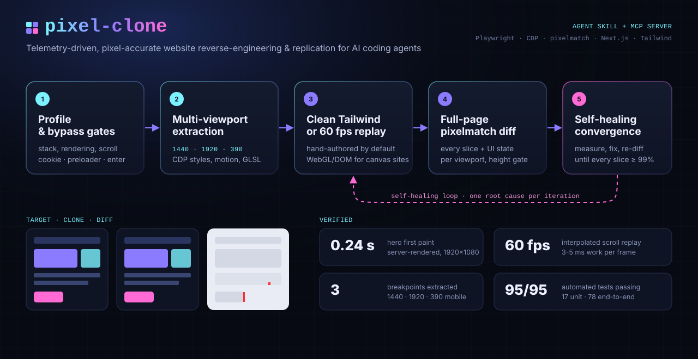
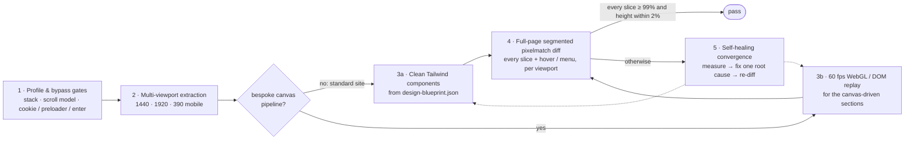

<div align="center">

# pixel-clone

**Telemetry-driven pixel-accurate website reverse-engineering & replication engine for AI coding agents**

[](LICENSE)
[](#verify)
[](#the-6-mcp-tools)
[](#install)
[](package.json)



[Install](#install) · [How it works](#how-it-works) · [Benchmarks](#verified-benchmarks) · [MCP tools](#the-6-mcp-tools) · [Rules](#engineering-rules)

</div>

---

## What it does

`pixel-clone` is an **Agent Skill + MCP server** that turns a website you own (or may replicate) into a **Next.js + Tailwind CSS** project whose every color, size, font metric, easing curve, camera and shader value was **measured**, not guessed. It then proves the result with a **full-page, multi-viewport `pixelmatch` loop** and keeps fixing until every slice of the page matches, or reports exactly why it cannot.

## Why it is different

| | Screenshot-to-code guessing | **pixel-clone** |
|---|---|---|
| Source of every value | Estimated from a picture | Computed styles, boxes, fonts and keyframes read through the **Chrome DevTools Protocol** |
| Layout | One viewport, fixed pixels | Per-element responsive rules fitted at **1440×900 + 1920×1080**, plus a **390×844** mobile pass |
| Motion | "ease-in-out, ~300 ms" | Exact `cubic-bezier`, keyframes and scroll curves on a **frame-stepped virtual clock** |
| WebGL / 3D | A lookalike or a placeholder | Scene graph, **compiled GLSL**, uniforms, textures and the recorded render-pass list |
| Code it writes | Whatever the model produced | **Hand-authored Tailwind** from design tokens; WebGL/DOM replay only for bespoke canvas pipelines |
| Verification | "Looks close" | `pixelmatch` on **every vertical slice and UI state, per viewport**, plus a page-height gate |
| When it is not exact | Silent | Per-slice numbers, hotspots and explicit stop conditions |

## How it works



| Stage | What happens |
|---|---|
| **1 Profile** | Loads the site robustly, clears cookie banners, age gates, preloaders and "Enter" screens, detects the stack (WebGL, three.js, GSAP, Lenis, virtual scrollers, video) and decides the scaffold. |
| **2 Extract** | DOM + computed styles, design tokens, fonts, assets, `@keyframes`, a full-height section inventory, responsive rules across viewports, motion timelines, WebGL scenes and shaders. Everything lands in `design-blueprint.json`. |
| **3 Generate** | Standard sites get clean, human-readable React + Tailwind components. Only a viewport-covering canvas on a scroll-driven page unlocks the dump-and-replay runtime (responsive, progressive, 60 fps interpolated). |
| **4 Diff** | Target and clone captured slice by slice over the whole page, plus interactive states, at each viewport, deterministically (virtual time, frozen media, parked pointer). |
| **5 Converge** | The agent reads the red diff mask, finds one root cause, measures the true value, fixes, re-diffs, and stops only on a pass or an honest, documented plateau. |

## Verified benchmarks

Measured on this repository's own runtime and test suite (local production builds, headless Chrome; GPU numbers on an RTX 4050 laptop GPU). The case study is a production WebGL scroll-story site.

| Metric | Result | Measured how |
|---|---|---|
| Hero first paint | **0.24 s** at 1920×1080 (0.22–0.40 s across 1440 / 1920 / 2560 wide) | Server-rendered hero UI + baked hero poster, `first-contentful-paint` |
| Scroll replay | **60 fps** median, **3–5 ms** work per drawn frame, 50–70 interpolated states per scroll | Continuous scroll, `verify-clone.mjs --gpu` |
| Responsive extraction | **3 breakpoints**: 1440×900 + 1920×1080 per-element fit, 390×844 mobile pass | Fixture suite: right-anchored HUD, full-bleed bars, stacked grids, mobile nav toggle, fluid type |
| Full-bleed rendering | Canvas covers the window at **1440×900, 1920×1080, 2560×1080** | Runtime check, all three sizes |
| Canvas z-layer interleaving | **17 / 17** decorations painted under the WebGL canvas, as on the target | Browser paint order (`elementsFromPoint`) in the clone |
| Video frame sync | Held at the recorded frame (**3.084 s → 3.084 s**) during diffs; plays on for visitors | Clone runtime check |
| Determinism | **100%** on identical pages; animated WebGL page vs itself **100%** with `freezeTime` | E2E suite |
| Case study accuracy (bespoke WebGL scroll story) | **96.6%** / **95.6%** mean per-slice similarity at 1440 / 1920, page height exact at both | Full-page diff, 21 states per viewport. Not yet a pass: time-animated art and the site's own nondeterminism remain |
| Cold start | **14 s** from a bare checkout to a connected MCP client | `scripts/mcp-launch.mjs` bootstrap |
| Automated tests | **95 / 95** passing | 17 unit + 78 end-to-end (fixtures and live pages) |

## Install

Requires **Node ≥ 20.9** and git. Replace `MONTASSAR2001` with the GitHub account that hosts this repository.

```bash
npx skills add MONTASSAR2001/pixel-clone-skill        # the skill, for every agent `skills` supports
cd <path-to>/pixel-clone && npm run setup  # deps + build + Playwright Chromium, one command
```

Every client starts the server with `node scripts/mcp-launch.mjs`. On a fresh install (plugin, extension, or clone without `npm run setup`), the launcher installs and builds on its first start (about 15 s) and uses the system Chrome until `npm run setup` provides the bundled Chromium. Use absolute paths in the snippets below.

<details open>
<summary><b>Claude Code</b>: plugin with the skill and the MCP server in one step</summary>

```bash
claude plugin marketplace add MONTASSAR2001/pixel-clone-skill
claude plugin install pixel-clone@pixel-clone-skill
```

Or manually, after `npx skills add`:

```bash
claude mcp add pixel-clone -- node /abs/path/to/pixel-clone/scripts/mcp-launch.mjs
```
</details>

<details>
<summary><b>Cursor</b>: <code>~/.cursor/mcp.json</code> (or <code>.cursor/mcp.json</code> per project)</summary>

```json
{
  "mcpServers": {
    "pixel-clone": {
      "command": "node",
      "args": ["/abs/path/to/pixel-clone/scripts/mcp-launch.mjs"]
    }
  }
}
```
</details>

<details>
<summary><b>Antigravity</b>: <code>~/.gemini/config/mcp_config.json</code> (or <code>&lt;workspace&gt;/.agents/mcp_config.json</code>)</summary>

Skill: `npx skills add`, or place this repository at `~/.gemini/config/skills/pixel-clone/` (all workspaces) or `<workspace>/.agents/skills/pixel-clone/`.

```json
{
  "mcpServers": {
    "pixel-clone": {
      "command": "node",
      "args": ["/abs/path/to/pixel-clone/scripts/mcp-launch.mjs"]
    }
  }
}
```
</details>

<details>
<summary><b>Windsurf / Devin Local</b>: <code>~/.codeium/windsurf/mcp_config.json</code> or <code>~/.config/devin/mcp_config.json</code></summary>

Windsurf's current documentation lives under Devin Local: `~/.config/devin/mcp_config.json` (user), `.devin/mcp_config.json` (project), `%APPDATA%\devin\mcp_config.json` (Windows). Classic Windsurf reads `~/.codeium/windsurf/mcp_config.json`. Same shape everywhere:

```json
{
  "mcpServers": {
    "pixel-clone": {
      "command": "node",
      "args": ["/abs/path/to/pixel-clone/scripts/mcp-launch.mjs"]
    }
  }
}
```
</details>

<details>
<summary><b>Gemini CLI</b>: extension, or <code>~/.gemini/settings.json</code></summary>

```bash
gemini extensions install https://github.com/MONTASSAR2001/pixel-clone-skill
```

`gemini-extension.json` loads `SKILL.md` as context and starts the server from the extension directory. Or register the server in `~/.gemini/settings.json` (all projects) or `.gemini/settings.json` (one project) with the same `mcpServers` block as above. Gemini CLI's own docs mark it as superseded by the Antigravity CLI.
</details>

> **Long tool calls.** A full-page diff of a GL-heavy site under software GL can take 10–30 minutes. Raise the client's tool timeout (Claude Code: `MCP_TOOL_TIMEOUT=3600000`; Gemini CLI: `"timeout"` in ms) and use `reuseTarget: true` so loop iterations only re-capture the clone.

### Use it

> *"Clone https://your-site.example into ./my-clone. Follow the pixel-clone skill."*

The agent profiles the site, scaffolds `templates/nextjs-clone-starter/` with only what the site needs, extracts, writes the sections and loops on `compare_visual_diff`, logging every iteration to `CLONE_NOTES.md`.

## The 6 MCP tools

| Tool | Purpose |
|---|---|
| `profile_site` | Run first. Clears gates, reports stack, rendering (WebGL1/2, three.js, canvas 2D), scroll model, media, fixed layers, and `recommendedScaffold` (including whether replay is allowed, with reasons). |
| `scan_page_sections` | Full-height section inventory: visible text, containers, media, fixed layers and WebGL passes per viewport slice (`inventory.md`). Every section is mandatory. |
| `extract_dom_and_styles` | Computed styles and boxes, `::before/::after`, SVG, tokens, CSS variables, `@font-face`, `@keyframes`, breakpoints, assets, `design-blueprint.json`; responsive rules at 1440 + 1920; optional 390×844 mobile pass. |
| `capture_motion_timeline` | Every CSS animation/transition with exact keyframes and `cubic-bezier`, frame-stepped scroll checkpoints, hover deltas, smooth-scroll curve, GSAP/ScrollTrigger when reachable. |
| `inspect_webgl_scene` | WebGL1/2 + three.js: renderer, cameras, lights, meshes, materials, textures, raw GLSL and uniforms, models; `frameTrace` records a full frame's render passes. |
| `compare_visual_diff` | Full-page segmented `pixelmatch`: every slice + hover / menu / custom interactions, per viewport (mobile included), height gate, `overview.png`; can dump replay state from the compared session. |

Companion scripts (`scripts/`): `scaffold.mjs` (profile-driven starter), `stage-replay.mjs`, `three-scene-dump.mjs`, `dom-layer-dump.mjs`, `bake-hero-poster.mjs`, `verify-clone.mjs` (runtime checks: first paint, full-bleed, fps, interpolation, hero-first), `call-tool.mjs`, `side-by-side.mjs`.

## Engineering rules

The skill (`SKILL.md`) is strict by design:

- **Measure, never guess.** Every value traces back to tool output; no Tailwind-preset rounding, no generic defaults.
- **Hand-authored first.** Standard sites are written as clean React + Tailwind. Replay is reserved for bespoke scroll-driven canvas pipelines, and the scaffold omits it otherwise.
- **The whole page, at every viewport.** Section-by-section inventory, one component per section, document height matched, responsive rules instead of fixed 1440 px geometry, a mobile pass when in scope.
- **The hero opens the page.** Post-visit states appear only after a real visit, and only when the target really has one.
- **Fast and smooth.** Server-rendered hero, prefetched data, progressive streaming, interpolated 60 fps scrolling, the target's own transition curves, graceful fallback without WebGL.
- **Honest results.** A clone passes only when every slice and state is ≥ 99%; otherwise the per-slice table and the remaining causes are reported.

## Verify

```bash
npm test                      # 17 unit tests: CSS parsing, blueprint, responsive fitter, replay runtime math
npm run test:e2e              # 78 end-to-end checks: fixtures + live pages
E2E_LIVE=0 npm run test:e2e   # fixtures only
claude plugin validate .      # Claude Code plugin + marketplace manifests
```

## Responsible use and limits

- Use it only on sites you own or have permission to replicate. Third-party text, imagery, fonts, models and video stay local (`.clone-output/`, gitignored) and are never committed or published.
- ≥ 99% is realistic for static and standard layouts. Live data, ads, third-party iframes, bot walls, time-animated art and GPU-specific rasterization can cap the score; the loop has stop conditions and reports real numbers.
- Software GL (SwiftShader) keeps captures deterministic but can cost seconds per frame on heavy scenes.

## Repository layout

```
SKILL.md                         the skill (Agent Skills format): workflow, rules, diagnosis table
assets/architecture.svg          pipeline diagram
.claude-plugin/                  Claude Code plugin + marketplace manifests (skill + MCP server)
gemini-extension.json            Gemini CLI extension manifest
mcp-server/src                   TypeScript MCP server (Playwright + CDP + pixelmatch), built to mcp-server/dist
scripts/                         mcp-launch (entry for every client), setup helpers, dump/stage/verify/bake, e2e + fixtures
templates/nextjs-clone-starter   Next.js + Tailwind v4 starter; GSAP, Framer Motion, R3F and replay runtime kept per profile
test/                            unit tests
```

---

<div align="center">

Built by **Montassar Zarai** · Released under the [MIT License](LICENSE)

</div>
